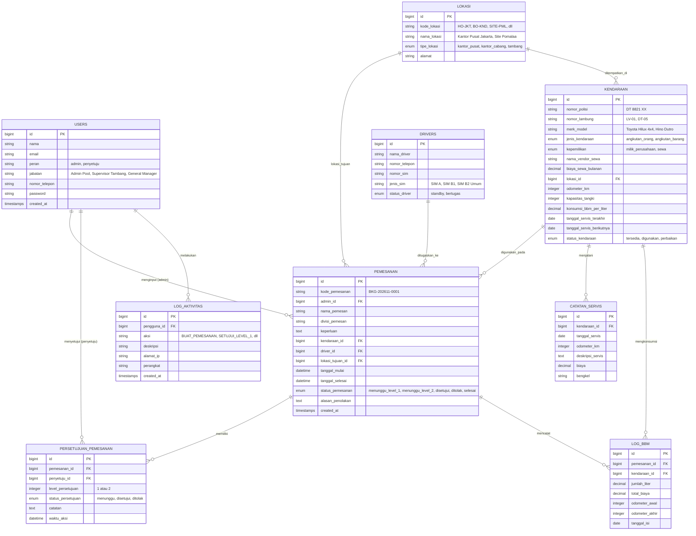

# Product Requirement Document (PRD)

**Nama Sistem:** NikelFleet — Sistem Monitoring & Pemesanan Kendaraan Operasional Tambang  
**Dokumen:** Spesifikasi Kebutuhan Teknis, Alur Bisnis & Data Model  
**Target:** Fullstack Web Application (Mobile-First & Responsive Desktop)  
**Status Dokumen:** Approved / Siap Implementasi  

---

## 1. Latar Belakang & Masalah yang Mau Diselesaikan

Perusahaan tambang nikel ini memiliki area operasional yang luas dan tersebar di beberapa lokasi strategis:
- **1 Kantor Pusat (Head Office)** di Jakarta.
- **1 Kantor Cabang (Branch Office)** di Kendari.
- **6 Lokasi Tambang (Site)**: Site Pomalaa, Site Morowali, Site Halmahera, Site Konawe, Site Sorowako, dan Site Kolaka.

Armada kendaraan yang dikelola sangat beragam dan bernilai tinggi:
- **Kategori Jenis:** 
  - *Angkutan Orang*: Double Cabin 4x4, SUV Patroli Lapangan, Minibus Operasional, Bus Karyawan.
  - *Angkutan Barang*: Dump Truck Tambang, Truk Logistik, Flatbed Cargo, Pick-up Utility.
- **Kategori Kepemilikan:**
  - *Milik Perusahaan (Company-Owned)*.
  - *Sewa (Rental)* dari pihak ketiga (vendor rental kendaraan).

### Masalah Utama:
1. Penggunaan kendaraan operasional di area tambang membutuhkan kontrol ketat. Kendaraan tidak boleh sembarangan keluar dari pool tanpa izin resmi.
2. Setiap pemakaian harus disetujui secara berjenjang oleh atasan (minimal 2 level persetujuan: Atasan Pemohon/Pool Manager dan Kepala Wilayah/General Manager).
3. Manajemen membutuhkan transparansi data terkait **konsumsi BBM**, **jadwal servis berkala**, serta **riwayat pemakaian kendaraan**.
4. Diperlukan kemudahan bagi atasan untuk melakukan persetujuan secara cepat melalui smartphone di lapangan (*mobile-first*), serta kemudahan bagi admin untuk mengolah laporan dan grafik di komputer kantor (*desktop*).

---

## 2. Pengguna Sistem & Hak Akses (User Roles)

Sistem membedakan hak akses menjadi 2 kelompok pengguna:

### A. Admin (Pengelola Pool Kendaraan)
1. Login dan autentikasi aman.
2. Mengelola master data: Kendaraan, Driver, Lokasi/Site Tambang, dan Vendor Sewa.
3. Menginput formulir pemesanan kendaraan saat ada permohonan dinas/operasional.
4. Menentukan unit kendaraan, menugaskan Driver, serta memilih pihak penyetuju (Approver Level 1 dan Approver Level 2).
5. Memantau konsumsi BBM, mencatat kilometer odometer, dan memantau tanggal servis kendaraan.
6. Melihat dashboard analitik dan grafik pemakaian kendaraan.
7. Memfilter dan mengekspor laporan pemesanan periodik ke file Excel (.xlsx).
8. Memeriksa riwayat aktivitas sistem (*Activity / Audit Log*).

### B. Pihak Penyetuju (Approver / Atasan Level 1 & Level 2)
1. Login dan autentikasi aman.
2. Membuka dashboard permohonan persetujuan (dioptimalkan untuk tampilan mobile smartphone).
3. Melihat detail pengajuan: siapa pemesan, tujuan perjalanan (kantor/site tambang), kendaraan yang diajukan, driver, tanggal & jam berangkat-kembali.
4. Melakukan aksi:
   - **Setujui (Approve)** dengan catatan opsional.
   - **Tolak (Reject)** dengan alasan penolakan wajib diisi.
5. Melihat riwayat pemesanan yang pernah disetujui atau ditolak sebelumnya.

---

## 3. Data Master & Entitas Bisnis

Data master yang akan di-seed ke sistem dibuat realistis sesuai kondisi tambang nikel:

### A. Lokasi Operasional (8 Titik)
1. `HO-JKT`: Head Office Jakarta (Kantor Pusat)
2. `BO-KND`: Branch Office Kendari (Kantor Cabang)
3. `SITE-PML`: Site Tambang Pomalaa
4. `SITE-MRW`: Site Tambang Morowali
5. `SITE-HLM`: Site Tambang Halmahera
6. `SITE-KNW`: Site Tambang Konawe
7. `SITE-SRW`: Site Tambang Sorowako
8. `SITE-KLK`: Site Tambang Kolaka

### B. Kendaraan (Vehicles)
- **Atribut:** Nomor Polisi, Kode/Nomor Lambung, Merk & Model, Kategori (Orang / Barang), Status Kepemilikan (Milik Sendiri / Sewa), Nama Vendor Rental (jika sewa), Nilai Biaya Sewa/Bulan, Kapasitas Tangki, Konsumsi BBM Rata-rata (KM/Liter), Odometer Saat Ini (KM), Tanggal Servis Terakhir, Tanggal Servis Berikutnya, dan Status Ketersediaan (`Tersedia`, `Sedang Digunakan`, `Dalam Perbaikan/Servis`).

### C. Pengemudi (Drivers)
- **Atribut:** Nama Lengkap, Nomor Telepon, Nomor SIM, Golongan SIM (SIM A, SIM B1, SIM B2 Umum), Status (`Siap Tugas`, `Sedang Bertugas`).

---

## 4. Alur Bisnis & Activity Diagram (Persetujuan 2 Level)

Alur persetujuan berjalan secara sekuensial (berurutan) dan tidak boleh melompati level wewenang:

```mermaid
activityDiagram
state "Pemesanan Dibuat oleh Admin" as S1
state "Status: PENDING_LEVEL_1" as S2
state "Review oleh Approver Level 1" as S3
state "Status: PENDING_LEVEL_2" as S4
state "Review oleh Approver Level 2" as S5
state "Status: APPROVED (Siap Jalan)" as S6
state "Status: REJECTED (Ditolak)" as S_REJ
state "Operasional Selesai & Input BBM/KM" as S7
state "Status: COMPLETED (Selesai)" as S8

[*] --> S1
S1 --> S2
S2 --> S3
S3 --> S_REJ : Ditolak (L1)
S3 --> S4 : Disetujui (L1)
S4 --> S5
S5 --> S_REJ : Ditolak (L2)
S5 --> S6 : Disetujui (L2)
S6 --> S7 : Perjalanan Selesai
S7 --> S8
S_REJ --> [*]
S8 --> [*]
```

### Penjelasan Status Pemesanan:
1. `pending_level_1` (Kuning): Pesanan baru saja dibuat oleh Admin, menunggu tinjauan Atasan Level 1.
2. `pending_level_2` (Biru): Telah disetujui oleh Atasan Level 1, menunggu tinjauan Atasan Level 2.
3. `approved` (Hijau Muda): Telah disetujui oleh kedua level, kendaraan dan driver resmi dijadwalkan jalan (*On Duty*).
4. `rejected` (Merah): Ditolak di salah satu level (dilengkapi catatan alasan penolakan).
5. `completed` (Hijau Tua): Perjalanan dinas selesai, admin menginput data pemakaian BBM dan kilometer akhir.

---

## 5. Physical Data Model (PDM) & Struktur Tabel (Bahasa Indonesia)

Berikut rancangan struktur tabel relasional dengan nama atribut berbahasa Indonesia yang saling terhubung:



---

## 6. Fitur Aplikasi Secara Terperinci

### Fitur 1: Dashboard Analitik & Monitoring
- **Metrik Utama (Cards):**
  - Total Armada Kendaraan.
  - Kendaraan Aktif / Sedang Beroperasi (*On Duty*).
  - Permohonan Menunggu Persetujuan (*Pending Approval*).
  - Kendaraan yang Mendekati/Melewati Jadwal Servis.
- **Visualisasi Grafik (Chart.js / ApexCharts):**
  - *Grafik 1 (Bar Chart):* Tren Frekuensi Pemakaian Kendaraan per Bulan/Minggu.
  - *Grafik 2 (Pie/Doughnut Chart):* Rasio Pemakaian Angkutan Orang vs Angkutan Barang.
  - *Grafik 3 (Doughnut Chart):* Rasio Kendaraan Milik Sendiri vs Sewa Pihak Ketiga.
  - *Grafik 4 (Bar Chart):* Akumulasi Konsumsi BBM per Site Tambang.

### Fitur 2: Manajemen & Form Pemesanan Kendaraan
- Input cepat data pemesan, keperluan dinas, dan tujuan lokasi (Pusat, Cabang, atau 6 Site Tambang).
- Dropdown dinamis unit kendaraan (hanya menampilkan unit yang statusnya `available`).
- Dropdown driver yang sedang `standby`.
- Dropdown pemilihan Approver Level 1 (misal: Supervisor Lapangan/Pool Head) dan Approver Level 2 (misal: Kepala Wilayah / General Manager).
- Validasi pencegahan jadwal bentrok (*double booking*).

### Fitur 3: Sistem Approval Berjenjang (Mobile-Friendly Card View)
- Tampilan kartu permohonan yang simpel, jelas, dan ramah layar smartphone.
- Detail informasi permohonan langsung terlihat tanpa harus klik banyak halaman.
- Tombol aksi yang jelas:
  - Hijau: "Setujui Permohonan" (bisa menyertakan catatan persetujuan).
  - Merah: "Tolak Permohonan" (wajib memasukkan alasan penolakan).
- Status level bertingkat: L1 selesai $\rightarrow$ otomatis dialihkan ke antrean L2.

### Fitur 4: Monitoring BBM & Servis Kendaraan
- Pencatatan liter BBM, total biaya, dan jarak tempuh (KM) per perjalanan.
- Halaman tabel jadwal servis kendaraan dengan indikator warna status servis (Aman, Segera Servis, Terlambat Servis).

### Fitur 5: Laporan Periodik & Ekspor Excel (.xlsx)
- Filter pemesanan berdasarkan:
  - Rentang tanggal keberangkatan (Tanggal Awal - Tanggal Akhir).
  - Status pesanan (`Semua`, `Disetujui`, `Selesai`, `Ditolak`).
  - Lokasi tujuan (Pusat, Cabang, Site 1-6).
  - Jenis kendaraan (Angkutan Orang / Angkutan Barang).
- Tombol **Export Excel**: Menghasilkan file Excel resmi berformat `.xlsx` dengan styling tabel rapi (header berwarna, alignment rapi, border, dan summary total).

### Fitur 6: Activity / Audit Log *(Poin Tambahan)*
- Setiap aksi transaksi tercatat otomatis ke tabel `activity_logs`:
  - Siapa pengguna yang mengeksekusi.
  - Tipe aksi (misal: `BUAT_PEMESANAN`, `SETUJUI_LEVEL_1`, `SETUJUI_LEVEL_2`, `TOLAK_PEMESANAN`).
  - Waktu transaksi dan IP/perangkat.

---

## 7. Rencana Antarmuka (UI/UX Roadmap)

### Tahap 1: Mobile-First Focus
- Dioptimalkan untuk resolusi smartphone (360px - 430px).
- Bottom Navigation Bar atau Drawer Menu yang responsif.
- Card list yang ringkas untuk antrean persetujuan atasan (tombol approve/reject sekali sentuh).
- Formulir input dengan keyboard numeric bawaan pada input angka/tanggal.

### Tahap 2: Desktop Expansion
- Tampilan lebar layar laptop/monitor (1024px ke atas).
- Sidebar navigasi tetap di sebelah kiri.
- Data table interaktif dengan fitur pagination, search, dan filter langsung.
- Layout dashboard multi-kolom yang menyajikan seluruh grafik dan ringkasan metrik secara proporsional.

---

## 8. Persyaratan Teknis & Dokumentasi (README)

Sesuai instruksi soal, dokumen README.md akan memuat:
1. **Daftar Akun Pengguna Demo:**
   - Admin: `admin@nikelfleet.com` / `password123`
   - Approver Level 1: `spv.tambang@nikelfleet.com` / `password123`
   - Approver Level 2: `gm.operasional@nikelfleet.com` / `password123`
2. **Spesifikasi Lingkungan:**
   - PHP Version: `^8.2 / ^8.3`
   - Framework: `Laravel 11` (atau REST API + Frontend Modern)
   - Database Version: `MySQL 8.0` / `PostgreSQL 15` / `SQLite`
3. **Panduan Instalasi & Penggunaan:**
   - Langkah clone repositori Git.
   - Setup file `.env`.
   - Menjalankan migrasi dan seeder data awal (`db:seed`).
   - Panduan cara mencoba alur pemesanan dan approval 2 level dari awal sampai selesai.

---

## 9. Rencana Pengembangan Fitur Masa Depan (Future Development Roadmap)

Untuk meningkatkan efisiensi dan keandalan sistem dalam jangka panjang pada skala industri tambang terintegrasi, berikut adalah peta jalan (*roadmap*) pengembangan fitur lanjutan:

### A. Telematika IoT & Pelacakan GPS Real-Time (Geofencing Site Tambang)
- **Deskripsi:** Pemasangan modul GPS Tracker & OBD-II (On-Board Diagnostics) pada setiap unit armada.
- **Manfaat:**
  - Pelacakan koordinat posisi armada secara *real-time* di peta OpenStreetMap / Google Maps.
  - Fitur *Geofencing*: Alarm otomatis jika kendaraan keluar dari perimeter batas izin area konsesi tambang tanpa persetujuan dinas.
  - Pengukuran otomatis jam kerja mesin (*Engine Hour Meter*) untuk dump truck dan alat berat.

### B. Notifikasi Instan Multi-Channel (WhatsApp Business API & Telegram Bot)
- **Deskripsi:** Pengiriman *push notification* otomatis ke smartphone atasan ketika ada permohonan yang membutuhkan persetujuan.
- **Fitur:**
  - Tombol *One-Click Approval* langsung di dalam pesan WhatsApp/Telegram tanpa harus membuka browser terlebih dahulu.
  - Notifikasi pengingat (*auto-reminder*) jika pengajuan persetujuan belum direspons dalam kurun waktu 2 jam.

### C. AI / OCR Scanner Struk Pembelian BBM & Surat Jalan
- **Deskripsi:** Integrasi Vision AI (Gemini Flash / Tesseract OCR) pada form penyelesaian perjalanan dinas.
- **Manfaat:**
  - Driver/Admin cukup memotret struk SPBU atau bon solar industri; sistem otomatis mengekstrak nominal biaya, jumlah liter, dan tanggal pembelian secara akurat tanpa *human-error* input manual.
  - Verifikasi keaslian nota dinas dan pelaporan otomatis ke divisi *Finance & Accounting*.

### D. Predictive Maintenance Berbasis Machine Learning
- **Deskripsi:** Model prediktif yang memproyeksikan kapan komponen kendaraan (rem, oli mesin, ban tambang, filter) harus diganti sebelum terjadi kerusakan (*breakdown*).
- **Manfaat:**
  - Mencegah *downtime* operasi tambang yang mahal akibat kerusakan armada di tengah jalur *hauling*.
  - Mengoptimalkan alokasi anggaran suku cadang dan memonitor riwayat performa bengkel vendor.

### E. Progressive Web App (PWA) Offline-First untuk Area Blank Spot
- **Deskripsi:** Mengingat banyak pit tambang nikel di pelosok Sulawesi/Maluku yang memiliki keterbatasan sinyal internet (*blank spot*).
- **Fitur:**
  - Aplikasi web dapat di-*install* langsung ke layar utama smartphone seperti aplikasi native.
  - Penyimpanan data lokal (*IndexedDB / Service Worker*) yang memungkinkan pencatatan checklist inspeksi kendaraan harian (*pre-trip inspection*) saat offline, dan otomatis tersinkronisasi (*background sync*) saat perangkat kembali mendapat sinyal seluler atau Wi-Fi kantor site.

### F. Tanda Tangan Digital Tersertifikasi (Digital Signature - e-Meterai & QR Code)
- **Deskripsi:** Surat Jalan / Surat Izin Keluar Pool resmi dilengkapi dengan QR Code kriptografi dan tanda tangan digital terverifikasi.
- **Manfaat:**
  - Petugas keamanan (*Security Pos Utama Tambang*) cukup memindai QR Code menggunakan kamera ponsel untuk memverifikasi keabsahan izin keluar kendaraan secara cepat.

### G. Integrasi Enterprise Resource Planning (ERP SAP / Oracle NetSuite)
- **Deskripsi:** Modul API / Webhook dua arah untuk menghubungkan NikelFleet ke sistem ERP perusahaan.
- **Manfaat:**
  - Sinkronisasi biaya sewa vendor bulanan, depresiasi aset kendaraan, dan klaim biaya BBM langsung ke jurnal umum buku besar keuangan (*General Ledger*).
