# ⚡ NikelFleet — Sistem Monitoring & Pemesanan Kendaraan Operasional Tambang

> **TECHNICAL TEST — Fullstack Developer (Intern)**  
> **PT Sekawan Media Informatika**  
> Proyek: Sistem Monitoring, Persetujuan Berjenjang (Multi-Level Approval), & Pemesanan Kendaraan Tambang Nikel.

---

## 📋 Daftar Isi
1. [Tentang Sistem](#-tentang-sistem)
2. [Spesifikasi Teknis](#-spesifikasi-teknis)
3. [Daftar Akun & Kredensial Pengguna](#-daftar-akun--kredensial-pengguna)
4. [Alur Bisnis & Activity Diagram](#-alur-bisnis--activity-diagram)
5. [Physical Data Model (PDM)](#-physical-data-model-pdm)
6. [Fitur Unggulan](#-fitur-unggulan)
7. [Panduan Instalasi & Menjalankan Aplikasi](#-panduan-instalasi--menjalankan-aplikasi)
8. [Panduan Uji Coba Skenario (Testing Guide)](#-panduan-uji-coba-skenario-testing-guide)

---

## 🚀 Tentang Sistem
**NikelFleet** adalah aplikasi berbasis web yang dirancang untuk memonitoring armada kendaraan operasional pada perusahaan tambang nikel yang tersebar di 8 lokasi strategis:
- **1 Kantor Pusat:** Head Office Jakarta
- **1 Kantor Cabang:** Branch Office Kendari
- **6 Site Tambang:** Site Pomalaa, Site Morowali, Site Halmahera, Site Konawe, Site Sorowako, dan Site Kolaka.

Aplikasi mengelola armada **Angkutan Orang** dan **Angkutan Barang**, baik yang berstatus **Milik Sendiri** maupun **Sewa dari Vendor Rental**. Setiap pemesanan kendaraan wajib melalui **Persetujuan Berjenjang minimal 2 Level** (Atasan Langsung/Spv $\rightarrow$ General Manager) sebelum kendaraan diizinkan beroperasi di lapangan.

---

## 📸 Tangkapan Layar Aplikasi (Screenshots Gallery)

### 1. Dashboard Eksekutif Admin & Visualisasi Grafik (Chart.js)
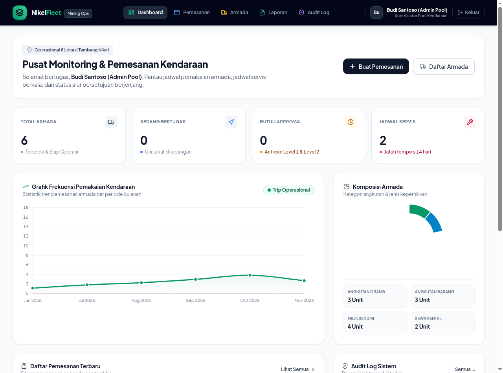

### 2. Portal Persetujuan Berjenjang (Approver Level 1 & Level 2)
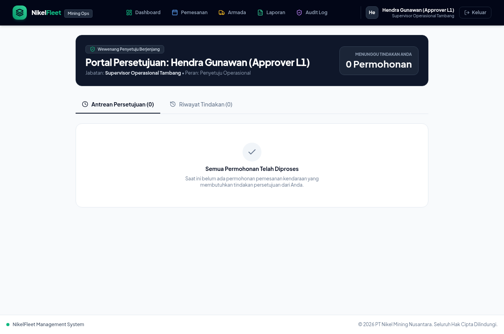

### 3. Monitoring Armada Tambang & Servis Berkala
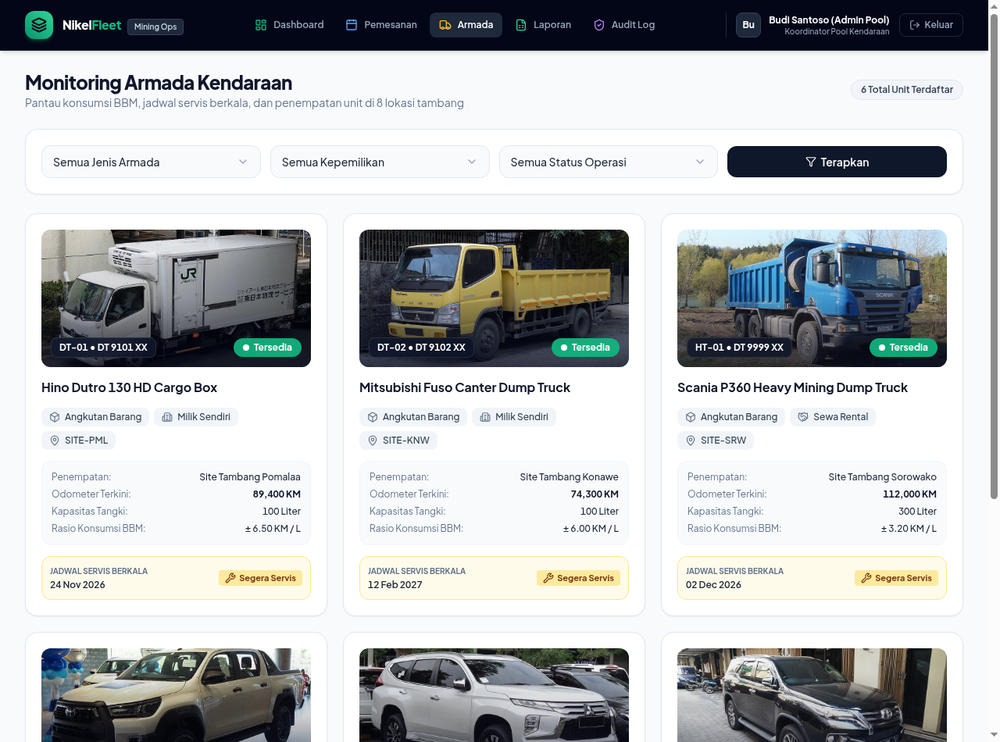

### 4. Manajemen Pemesanan Kendaraan
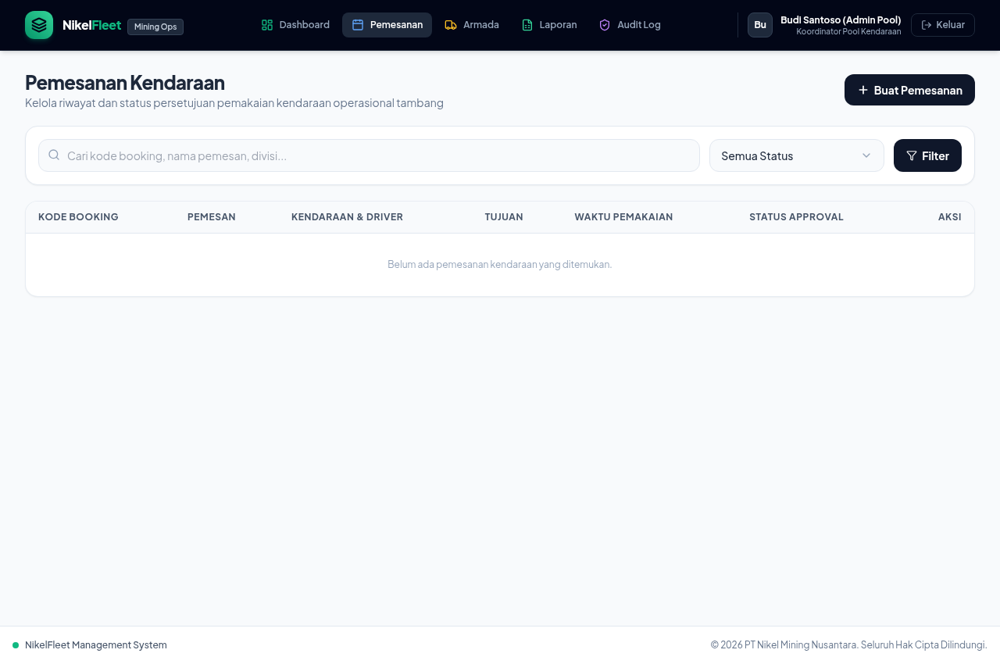

### 5. Laporan Periodik & Ekspor Dokumen Excel (.xls)
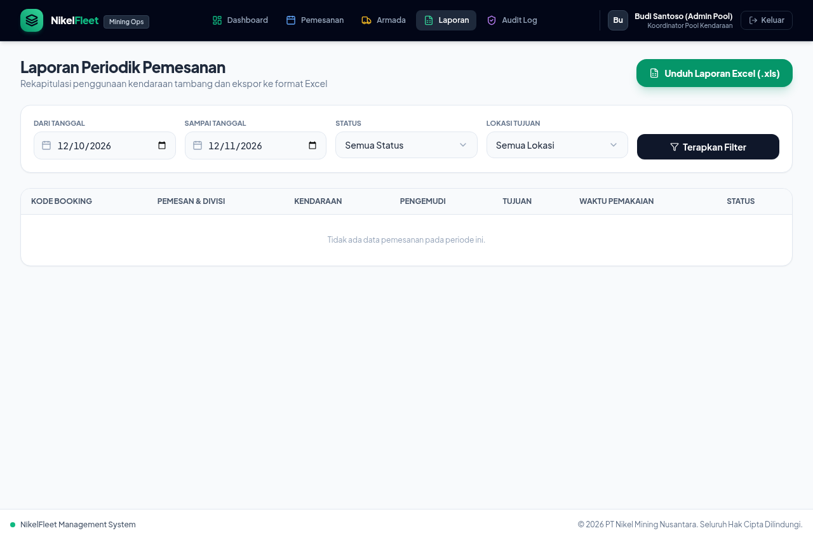

### 6. Audit Trail Forensik (Log Aktivitas Sistem)
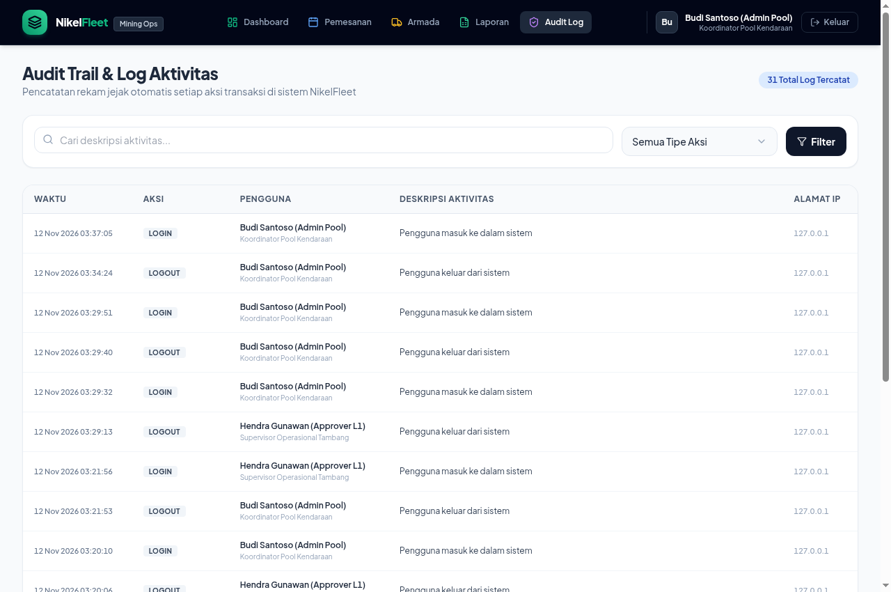

### 7. Responsif Mobile Smartphone (Mobile-First View)
| Mobile Dashboard Admin | Mobile Monitoring Armada |
|:---:|:---:|
| 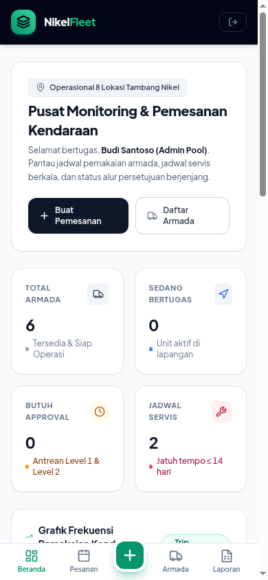 | 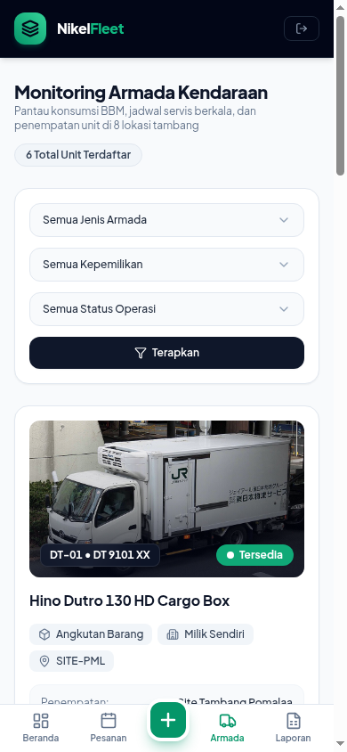 |

---

## 🛠 Spesifikasi Teknis
Sesuai dengan kriteria evaluasi teknis:
- **PHP Version:** `^8.2 / ^8.3 / ^8.5`
- **Framework:** `Laravel 11.x`
- **Database Version:** `SQLite 3` (Bawaan siap pakai) / Kompatibel dengan `MySQL 8.0+` & `PostgreSQL 15+`
- **Frontend Stack:** `Blade Template Engine`, `Tailwind CSS`, `Flowbite / Preline UI Components`
- **Icon Set:** `Lucide Icons` (Ultra crisp modern vector icons)
- **Reaktivitas UI:** `Alpine.js`
- **Micro-Interactions & Popups:** `SweetAlert2` & `Canvas-Confetti`
- **Visualisasi Grafik:** `Chart.js` (Interaktif & Animatif)
- **Format Ekspor Laporan:** Format Spreadsheet Excel (`.xls / .xlsx`)

---

## 👥 Daftar Akun & Kredensial Pengguna
Tersedia tombol **Quick-Fill 1-Klik** di halaman login untuk mempermudah pengujian:

| Role / Peran | Jabatan | Email | Password | Hak Akses Utama |
|---|---|---|---|---|
| **Admin Pool** | Koordinator Pool Kendaraan | `admin@nikelfleet.com` | `password123` | Input pemesanan, atur driver, monitoring BBM/servis, dashboard grafik, ekspor Excel, audit log |
| **Approver Level 1** | Supervisor Tambang | `spv.tambang@nikelfleet.com` | `password123` | Persetujuan Tahap 1 (Approve / Reject) |
| **Approver Level 2** | General Manager Operasional | `gm.operasional@nikelfleet.com` | `password123` | Persetujuan Tahap 2 Final (Approve / Reject) |

---

## 🔄 Alur Bisnis & Diagram Alur Data (Data Flow Diagram)

### A. State Diagram: Siklus Persetujuan Berjenjang
Persetujuan pemesanan kendaraan berjalan berurutan (*sequential multi-level approval*) tanpa loncat wewenang:

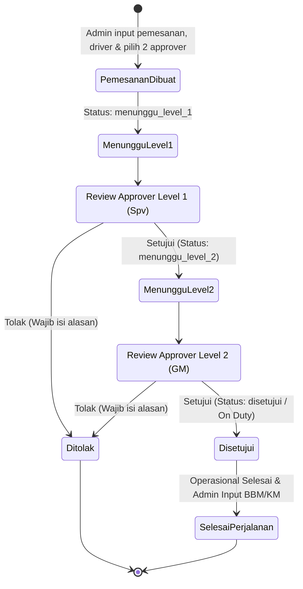

### B. Sequence Diagram: Alur Data Transaksi (Data Flow Transaction)
Diagram di bawah mendeskripsikan secara rinci pertukaran data antara pengguna, aplikasi, dan database relasional:

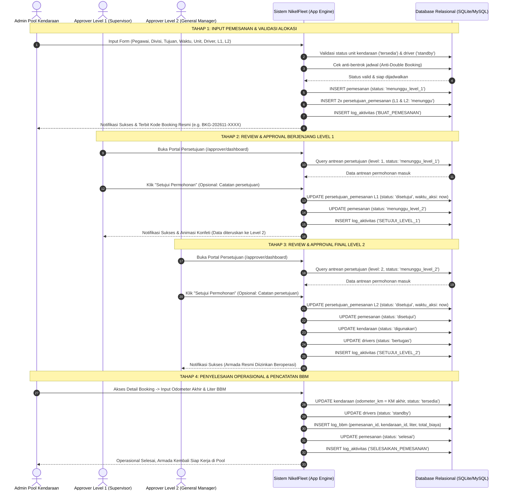

### C. Arsitektur Alur Data Modul Aplikasi (High-Level Architecture)

```mermaid
flowchart TD
    subgraph AktorPengguna ["Aktor Pengguna"]
        AdminUser["Admin Pool Kendaraan"]
        L1User["Approver Level 1 (Supervisor)"]
        L2User["Approver Level 2 (General Manager)"]
    end

    subgraph ModulAplikasi ["Modul Aplikasi NikelFleet"]
        M_Auth["Autentikasi & RBAC Middleware"]
        M_Pemesanan["Modul Pemesanan & Alokasi Armada"]
        M_Approval["Engine Persetujuan Berjenjang 2 Level"]
        M_Kendaraan["Monitoring Armada, BBM & Servis"]
        M_Dashboard["Dashboard Eksekutif & Chart.js"]
        M_Laporan["Modul Laporan Periodik & Export Excel"]
        M_Audit["Modul Audit Trail & Log Aktivitas"]
    end

    subgraph SkemaDatabase ["Database Relasional (SQLite / MySQL)"]
        T_Users[("users")]
        T_Lokasi[("lokasi (8 Sites)")]
        T_Kendaraan[("kendaraan & catatan_servis")]
        T_Drivers[("drivers")]
        T_Pemesanan[("pemesanan & persetujuan_pemesanan")]
        T_Log[("log_bbm & log_aktivitas")]
    end

    AdminUser --> M_Pemesanan
    M_Pemesanan -->|Cek Ketersediaan| T_Kendaraan
    M_Pemesanan -->|Cek Driver Standby| T_Drivers
    M_Pemesanan -->|Simpan Booking & 2 Level Wewenang| T_Pemesanan

    L1User --> M_Approval
    M_Approval -->|Validasi Tahap 1 -> Naikkan ke L2| T_Pemesanan

    L2User --> M_Approval
    M_Approval -->|Validasi Tahap 2 -> Status Disetujui| T_Pemesanan
    M_Approval -->|Ubah Status Armada Jadi 'digunakan'| T_Kendaraan
    M_Approval -->|Ubah Status Driver Jadi 'bertugas'| T_Drivers

    AdminUser --> M_Kendaraan
    M_Kendaraan -->|Input KM Akhir & Konsumsi BBM| T_Log
    M_Kendaraan -->|Kembalikan Unit Jadi 'tersedia'| T_Kendaraan

    T_Pemesanan & T_Kendaraan & T_Log --> M_Dashboard
    M_Dashboard -->|Render Grafik Tren & Donut Rasio| AdminUser

    T_Pemesanan & T_Lokasi & T_Kendaraan --> M_Laporan
    M_Laporan -->|Streaming File Excel .xls| AdminUser

    M_Pemesanan & M_Approval & M_Kendaraan --> M_Audit
    M_Audit -->|Catat Jejak Forensik Transaksi| T_Log
```

---

## 🗄 Physical Data Model (PDM)
Struktur skema relasional tabel database dengan nama atribut Bahasa Indonesia:


---

## ✨ Fitur Unggulan
1. **Multi-Level Sequential Approval:** Persetujuan tidak dapat dilompati (*anti-bypass*). Level 2 baru aktif setelah Level 1 menyetujui.
2. **Anti-Double Booking Validation:** Mencegah satu unit kendaraan dijadwalkan pada waktu yang bertabrakan.
3. **Dashboard Visual Chart.js:** Grafik interaktif tren pemakaian bulanan serta diagram rasio unit orang vs barang dan milik vs sewa.
4. **Monitoring Jadwal Servis & BBM:** Indikator jatuh tempo servis otomatis (Aman, Segera Servis, Overdue) dan pencatatan riwayat BBM.
5. **Ekspor Laporan Excel:** Download laporan periodik terformat (.xls) dengan styling tabel rapi.
6. **Audit Trail / Activity Log:** Rekam jejak seluruh aksi transaksi (siapa, aksi apa, jam berapa, alamat IP).
7. **Mobile-First UX:** Tampilan kartu touch-friendly, bottom navigation bar, dan dialog konfirmasi SweetAlert2 + efek animasi Confetti.

---

## 💻 Panduan Instalasi & Menjalankan Aplikasi

### 1. Clone Repositori
```bash
git clone <url-repo-anda>
cd sekawan_media
```

### 2. Salin Konfigurasi Environment
```bash
cp .env.example .env
```

### 3. Install Dependensi Composer
```bash
composer install
```

### 4. Generate Application Key & Migrasi Database
```bash
php artisan key:generate
touch database/database.sqlite
php artisan migrate:fresh --seed
```

### 5. Jalankan Web Server Lokal
```bash
php artisan serve
```
Aplikasi dapat langsung diakses melalui browser di: **`http://127.0.0.1:8000`**

---

## 🧪 Panduan Uji Coba Skenario (Testing Guide)

### Skenario 1: Admin Membuat Pemesanan
1. Buka `http://127.0.0.1:8000/login` lalu klik tombol **"Admin Pool Kendaraan"** (atau masukkan `admin@nikelfleet.com` / `password123`).
2. Masuk ke menu **"+ Buat Pemesanan"**.
3. Isi data pemesan (misal: Bambang - Divisi Geologi).
4. Pilih unit kendaraan yang berstatus *Tersedia*, pilih driver *Standby*, dan pilih Approver L1 (`spv.tambang@nikelfleet.com`) serta Approver L2 (`gm.operasional@nikelfleet.com`).
5. Klik **"Simpan & Ajukan Persetujuan"**.
6. Status pemesanan kini: `⏳ Menunggu Level 1`.

### Skenario 2: Approver Level 1 Menyetujui
1. Logout, lalu login sebagai Approver Level 1: `spv.tambang@nikelfleet.com` / `password123`.
2. Pada Antrean Persetujuan, permohonan tadi akan muncul.
3. Klik tombol hijau **"Setujui Permohonan (Level 1)"**, masukkan catatan (opsional), klik **"Ya, Setujui Sekarang!"**.
4. Efek partikel konfeti akan muncul dan status berubah menjadi: `⏳ Menunggu Level 2`.

### Skenario 3: Approver Level 2 Menyetujui (Final)
1. Logout, lalu login sebagai Approver Level 2: `gm.operasional@nikelfleet.com` / `password123`.
2. Klik tombol hijau **"Setujui Permohonan (Level 2)"**, masukkan catatan, klik **"Ya, Setujui Sekarang!"**.
3. Status berubah menjadi `✓ Disetujui (Siap Jalan)`. Unit kendaraan dan Driver otomatis berstatus `On Duty`.

### Skenario 4: Admin Menyelesaikan Perjalanan & Input BBM
1. Login kembali sebagai Admin.
2. Buka menu **Pemesanan** $\rightarrow$ klik **Detail** pada pemesanan yang disetujui tadi.
3. Di bagian bawah terdapat form **"Penyelesaian Tugas & Input BBM"**.
4. Masukkan Odometer Akhir (misal naik 80 KM) dan liter BBM yang digunakan.
5. Klik **"Selesaikan Perjalanan & Catat BBM"**.
6. Status pemesanan berubah menjadi `✓ Selesai`, unit kendaraan & driver kembali berstatus `Tersedia`.

### Skenario 5: Ekspor Laporan Excel
1. Masuk ke menu **"Laporan"**.
2. Pilih filter tanggal atau status jika diperlukan.
3. Klik tombol hijau **"Unduh Laporan Excel (.xls)"**.
4. File spreadsheet otomatis terunduh lengkap dengan header resmi dan ringkasan data.

---

## 📖 Panduan Lengkap Penggunaan Fitur-Fitur Aplikasi

Berikut adalah penjelasan fungsional detail dari setiap modul dan fitur utama di dalam **NikelFleet**:

### 1. Modul Autentikasi & Quick-Fill Demo (Login 1-Klik)
- **Halaman Login (`/login`):** Desain modern minimalis berstandar enterprise.
- **Tombol Quick-Fill 1-Klik:** Untuk mempermudah penguji, disediakan 3 tombol cepat:
  - `Admin Pool Kendaraan` $\rightarrow$ otomatis mengisi kredensial Admin.
  - `Approver L1 (Supervisor)` $\rightarrow$ otomatis mengisi kredensial Penyetuju Level 1.
  - `Approver L2 (General Manager)` $\rightarrow$ otomatis mengisi kredensial Penyetuju Level 2.
- **Role-Based Redirect:** Saat berhasil login, Admin langsung diarahkan ke `/admin/dashboard`, sedangkan Penyetuju otomatis diarahkan ke `/approver/dashboard`.

### 2. Modul Dashboard Eksekutif & Visualisasi Grafik (Chart.js)
- **4 Metrik Utama:**
  1. *Total Armada:* Jumlah unit terdaftar beserta status operasionalnya.
  2. *Sedang Digunakan:* Unit yang sedang beroperasi di site tambang.
  3. *Butuh Approval:* Total permohonan yang sedang menunggu tindakan persetujuan (L1 & L2).
  4. *Jadwal Servis:* Unit yang jatuh tempo servis dalam kurun waktu $\le 14$ hari ke depan.
- **Grafik Tren Pemakaian Bulanan:** Line & Bar chart dinamis yang memetakan fluktuasi intensitas perjalanan operasional antar-bulan.
- **Diagram Donut Rasio Armada:** Menampilkan proporsi *Angkutan Orang vs Angkutan Barang* serta rasio *Milik Sendiri vs Sewa (Rental)*.

### 3. Modul Pemesanan Kendaraan (`/admin/pemesanan`)
- **Tabel & Kartu Mobile:** Menyajikan daftar permohonan pemesanan lengkap dengan badge status berkode warna (*Menunggu Level 1*, *Menunggu Level 2*, *Disetujui*, *Selesai*, *Ditolak*).
- **Filter Cepat:** Filter data berdasarkan kata kunci pencarian (nama pemesan, kode booking) dan filter status.
- **Formulir Pengajuan (`/admin/pemesanan/create`):**
  - *Data Pemohon:* Nama pemakai, divisi/departemen, dan deskripsi agenda perjalanan.
  - *Rute & Waktu:* Pilihan 8 lokasi tujuan (Kantor Pusat, Kantor Cabang, atau 6 Site Tambang) dan jadwal berangkat-kembali.
  - *Alokasi Armada & Driver:* Hanya menampilkan unit kendaraan yang berstatus `tersedia` dan driver berstatus `standby`.
  - *Penunjukan Atasan Berjenjang:* Menunjuk Supervisor sebagai Penyetuju Level 1 dan GM sebagai Penyetuju Level 2 (sistem memvalidasi Penyetuju L1 dan L2 tidak boleh orang yang sama).

### 4. Portal Persetujuan Berjenjang (`/approver/dashboard`)
- **Tab Antrean Persetujuan:** Menampilkan kartu permohonan yang secara spesifik membutuhkan tindakan persetujuan dari akun login yang bersangkutan.
  - *Badge Level:* Menandai secara jelas apakah permohonan berada pada tahap Level 1 atau Level 2.
  - *Tombol Setujui:* Menampilkan dialog konfirmasi SweetAlert2 dengan opsi input catatan atasan. Begitu disetujui di Level 1, sistem otomatis menaikkan status ke Level 2. Begitu Level 2 menyetujui, armada langsung diubah ke status `digunakan` dan driver `bertugas`.
  - *Tombol Tolak:* Wajib menyertakan alasan penolakan formal yang akan tersimpan di database dan tampil di riwayat pemohon.
- **Tab Riwayat Tindakan:** Rekapitulasi permohonan masa lalu yang pernah disetujui atau ditolak oleh atasan bersangkutan.

### 5. Detail Pemesanan & Penyelesaian Perjalanan (`/admin/pemesanan/{id}`)
- **Sequential Stepper Timeline:** Indikator visual interaktif 4-tahap yang menunjukkan progres status pemesanan secara *real-time*:
  1. *Pengajuan Dibuat* $\rightarrow$ 2. *Persetujuan Level 1* $\rightarrow$ 3. *Persetujuan Level 2* $\rightarrow$ 4. *Selesai*.
- **Penyelesaian Tugas & Input BBM:**
  - Saat armada telah kembali dari perjalanan dinas tambang, Admin menginput KM Odometer Akhir dan jumlah liter BBM yang dikonsumsi beserta total biayanya.
  - Sistem secara otomatis mencatat riwayat ke tabel `log_bbm`, memperbarui odometer kendaraan, serta mengembalikan status kendaraan ke `tersedia` dan driver ke `standby`.

### 6. Modul Monitoring Armada, Servis & BBM (`/admin/kendaraan`)
- **Monitoring Seluruh Unit:** Menampilkan nomor lambung tambang (contoh: `LV-01`, `DT-01`), plat nomor, model kendaraan, dan kapasitas tangki.
- **Status Servis Berkala:** Menampilkan tanggal servis berikutnya dengan badge pintar:
  - `Jatuh Tempo` (Merah): Sudah melewati tanggal servis.
  - `Segera Servis` (Kuning): Jatuh tempo dalam waktu $\le 14$ hari.
  - `Terjadwal` (Abu-abu): Jadwal servis masih aman.
- **In-Frame Custom Dropdown Filter:** Filter berdasarkan jenis kendaraan (orang/barang), kepemilikan (milik/sewa), dan status operasi tanpa glitch tampilan pada perangkat mobile.

### 7. Modul Laporan Periodik & Ekspor Excel (`/admin/laporan`)
- **Filter Fleksibel:** Pengguna dapat menentukan rentang *Dari Tanggal*, *Sampai Tanggal*, *Status Pemesanan*, dan *Lokasi Tujuan*.
- **Pratinjau Data:** Tabel interaktif dan kartu mobile menampilkan ringkasan data sebelum dicetak.
- **Ekspor Dokumen Excel (.xls):** Sekali klik tombol **"Unduh Laporan Excel (.xls)"**, browser akan mengunduh dokumen spreadsheet resmi lengkap dengan kop laporan, informasi rentang periode, rekapitulasi penggunaan BBM, serta status persetujuan.

### 8. Modul Audit Trail & Log Aktivitas (`/admin/logs`)
- **Pencatatan Otomatis (Forensik Digital):** Setiap kali ada aksi penting (Buat Pemesanan, Setujui Level 1, Setujui Level 2, Tolak Pemesanan, Selesaikan Perjalanan, Login, Logout), sistem otomatis merekam:
  - *Waktu Kejadian (Timestamp)*
  - *Nama Pengguna & Role*
  - *Jenis Aksi (Action Type)*
  - *Deskripsi Rinci Transaksi*
  - *Alamat IP & User Agent (Perangkat)*


