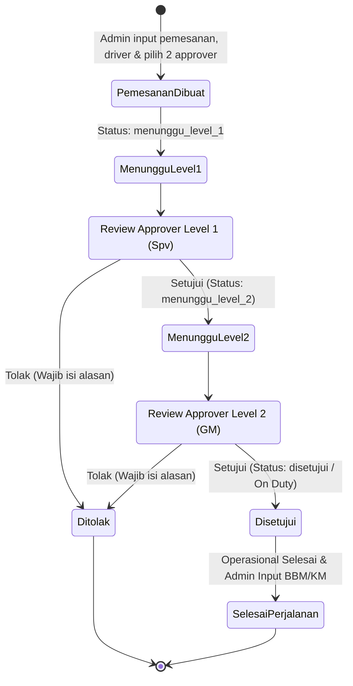
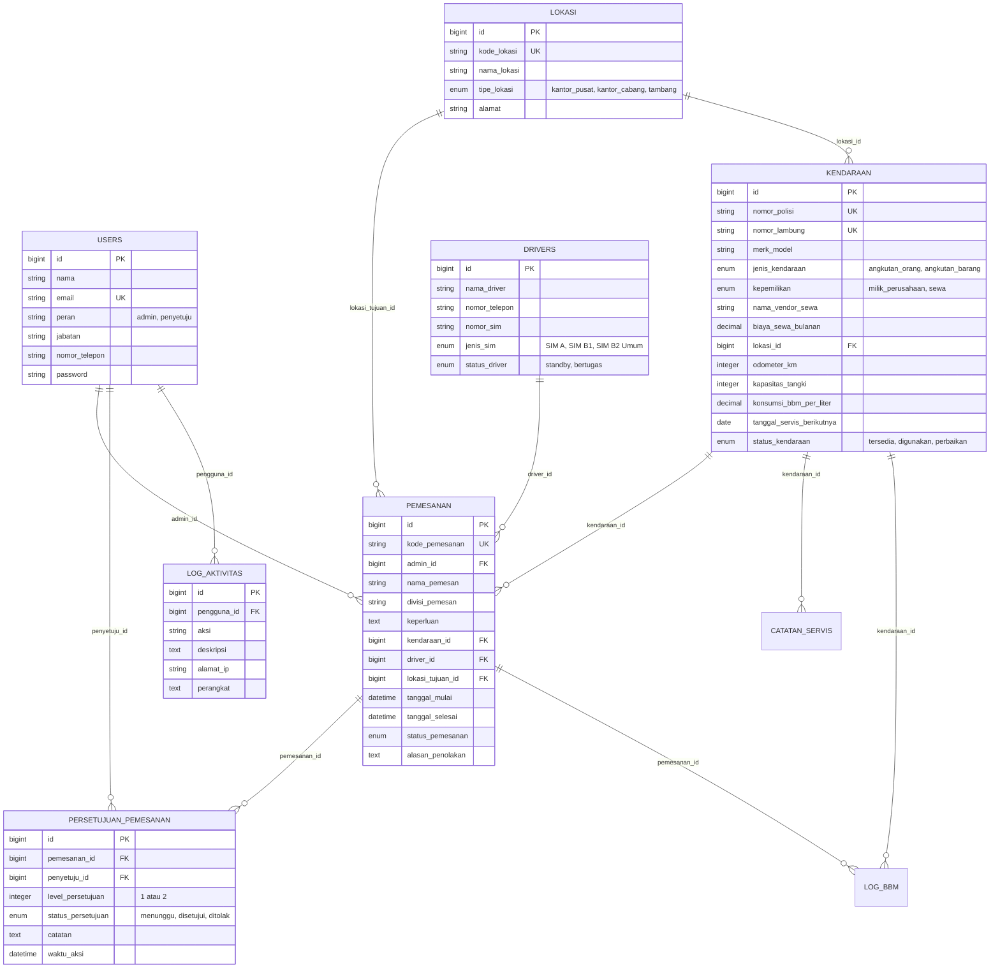

# ⚡ NikelFleet — Sistem Monitoring & Pemesanan Kendaraan Operasional Tambang

> **TECHNICAL TEST — Fullstack Developer (Intern)**  
> **PT Sekawan Media Informatika**  
> Proyek: Sistem Monitoring, Persetujuan Berjenjang (Multi-Level Approval), & Pemesanan Kendaraan Tambang Nikel.

---

## 📋 Daftar Isi
1. [Tentang Sistem](#-tentang-sistem)
2. [Spesifikasi Teknis](#-spesifikasi-teknis)
3. [Daftar Akun & Kredensial Pengguna](#-daftar-akun--kredensial-pengguna)
4. [Alur Bisnis & Activity Diagram](#-alur-bisnis--activity-diagram)
5. [Physical Data Model (PDM)](#-physical-data-model-pdm)
6. [Fitur Unggulan](#-fitur-unggulan)
7. [Panduan Instalasi & Menjalankan Aplikasi](#-panduan-instalasi--menjalankan-aplikasi)
8. [Panduan Uji Coba Skenario (Testing Guide)](#-panduan-uji-coba-skenario-testing-guide)

---

## 🚀 Tentang Sistem
**NikelFleet** adalah aplikasi berbasis web yang dirancang untuk memonitoring armada kendaraan operasional pada perusahaan tambang nikel yang tersebar di 8 lokasi strategis:
- **1 Kantor Pusat:** Head Office Jakarta
- **1 Kantor Cabang:** Branch Office Kendari
- **6 Site Tambang:** Site Pomalaa, Site Morowali, Site Halmahera, Site Konawe, Site Sorowako, dan Site Kolaka.

Aplikasi mengelola armada **Angkutan Orang** dan **Angkutan Barang**, baik yang berstatus **Milik Sendiri** maupun **Sewa dari Vendor Rental**. Setiap pemesanan kendaraan wajib melalui **Persetujuan Berjenjang minimal 2 Level** (Atasan Langsung/Spv $\rightarrow$ General Manager) sebelum kendaraan diizinkan beroperasi di lapangan.

---

## 🛠 Spesifikasi Teknis
Sesuai dengan kriteria evaluasi teknis:
- **PHP Version:** `^8.2 / ^8.3 / ^8.5`
- **Framework:** `Laravel 11.x`
- **Database Version:** `SQLite 3` (Bawaan siap pakai) / Kompatibel dengan `MySQL 8.0+` & `PostgreSQL 15+`
- **Frontend Stack:** `Blade Template Engine`, `Tailwind CSS`, `Flowbite / Preline UI Components`
- **Icon Set:** `Lucide Icons` (Ultra crisp modern vector icons)
- **Reaktivitas UI:** `Alpine.js`
- **Micro-Interactions & Popups:** `SweetAlert2` & `Canvas-Confetti`
- **Visualisasi Grafik:** `Chart.js` (Interaktif & Animatif)
- **Format Ekspor Laporan:** Format Spreadsheet Excel (`.xls / .xlsx`)

---

## 👥 Daftar Akun & Kredensial Pengguna
Tersedia tombol **Quick-Fill 1-Klik** di halaman login untuk mempermudah pengujian:

| Role / Peran | Jabatan | Email | Password | Hak Akses Utama |
|---|---|---|---|---|
| **Admin Pool** | Koordinator Pool Kendaraan | `admin@nikelfleet.com` | `password123` | Input pemesanan, atur driver, monitoring BBM/servis, dashboard grafik, ekspor Excel, audit log |
| **Approver Level 1** | Supervisor Tambang | `spv.tambang@nikelfleet.com` | `password123` | Persetujuan Tahap 1 (Approve / Reject) |
| **Approver Level 2** | General Manager Operasional | `gm.operasional@nikelfleet.com` | `password123` | Persetujuan Tahap 2 Final (Approve / Reject) |

---

## 🔄 Alur Bisnis & Activity Diagram
Persetujuan pemesanan kendaraan berjalan berurutan (*sequential multi-level approval*) tanpa loncat wewenang:



---

## 🗄 Physical Data Model (PDM)
Struktur skema relasional tabel database dengan nama atribut Bahasa Indonesia:



---

## ✨ Fitur Unggulan
1. **Multi-Level Sequential Approval:** Persetujuan tidak dapat dilompati (*anti-bypass*). Level 2 baru aktif setelah Level 1 menyetujui.
2. **Anti-Double Booking Validation:** Mencegah satu unit kendaraan dijadwalkan pada waktu yang bertabrakan.
3. **Dashboard Visual Chart.js:** Grafik interaktif tren pemakaian bulanan serta diagram rasio unit orang vs barang dan milik vs sewa.
4. **Monitoring Jadwal Servis & BBM:** Indikator jatuh tempo servis otomatis (Aman, Segera Servis, Overdue) dan pencatatan riwayat BBM.
5. **Ekspor Laporan Excel:** Download laporan periodik terformat (.xls) dengan styling tabel rapi.
6. **Audit Trail / Activity Log:** Rekam jejak seluruh aksi transaksi (siapa, aksi apa, jam berapa, alamat IP).
7. **Mobile-First UX:** Tampilan kartu touch-friendly, bottom navigation bar, dan dialog konfirmasi SweetAlert2 + efek animasi Confetti.

---

## 💻 Panduan Instalasi & Menjalankan Aplikasi

### 1. Clone Repositori
```bash
git clone <url-repo-anda>
cd sekawan_media
```

### 2. Salin Konfigurasi Environment
```bash
cp .env.example .env
```

### 3. Install Dependensi Composer
```bash
composer install
```

### 4. Generate Application Key & Migrasi Database
```bash
php artisan key:generate
touch database/database.sqlite
php artisan migrate:fresh --seed
```

### 5. Jalankan Web Server Lokal
```bash
php artisan serve
```
Aplikasi dapat langsung diakses melalui browser di: **`http://127.0.0.1:8000`**

---

## 🧪 Panduan Uji Coba Skenario (Testing Guide)

### Skenario 1: Admin Membuat Pemesanan
1. Buka `http://127.0.0.1:8000/login` lalu klik tombol **"Admin Pool Kendaraan"** (atau masukkan `admin@nikelfleet.com` / `password123`).
2. Masuk ke menu **"+ Buat Pemesanan"**.
3. Isi data pemesan (misal: Bambang - Divisi Geologi).
4. Pilih unit kendaraan yang berstatus *Tersedia*, pilih driver *Standby*, dan pilih Approver L1 (`spv.tambang@nikelfleet.com`) serta Approver L2 (`gm.operasional@nikelfleet.com`).
5. Klik **"Simpan & Ajukan Persetujuan"**.
6. Status pemesanan kini: `⏳ Menunggu Level 1`.

### Skenario 2: Approver Level 1 Menyetujui
1. Logout, lalu login sebagai Approver Level 1: `spv.tambang@nikelfleet.com` / `password123`.
2. Pada Antrean Persetujuan, permohonan tadi akan muncul.
3. Klik tombol hijau **"Setujui Permohonan (Level 1)"**, masukkan catatan (opsional), klik **"Ya, Setujui Sekarang!"**.
4. Efek partikel konfeti akan muncul dan status berubah menjadi: `⏳ Menunggu Level 2`.

### Skenario 3: Approver Level 2 Menyetujui (Final)
1. Logout, lalu login sebagai Approver Level 2: `gm.operasional@nikelfleet.com` / `password123`.
2. Klik tombol hijau **"Setujui Permohonan (Level 2)"**, masukkan catatan, klik **"Ya, Setujui Sekarang!"**.
3. Status berubah menjadi `✓ Disetujui (Siap Jalan)`. Unit kendaraan dan Driver otomatis berstatus `On Duty`.

### Skenario 4: Admin Menyelesaikan Perjalanan & Input BBM
1. Login kembali sebagai Admin.
2. Buka menu **Pemesanan** $\rightarrow$ klik **Detail** pada pemesanan yang disetujui tadi.
3. Di bagian bawah terdapat form **"Penyelesaian Tugas & Input BBM"**.
4. Masukkan Odometer Akhir (misal naik 80 KM) dan liter BBM yang digunakan.
5. Klik **"Selesaikan Perjalanan & Catat BBM"**.
6. Status pemesanan berubah menjadi `✓ Selesai`, unit kendaraan & driver kembali berstatus `Tersedia`.

### Skenario 5: Ekspor Laporan Excel
1. Masuk ke menu **"Laporan"**.
2. Pilih filter tanggal atau status jika diperlukan.
3. Klik tombol hijau **"Unduh Laporan Excel (.xls)"**.
4. File spreadsheet otomatis terunduh lengkap dengan header resmi dan ringkasan data.

